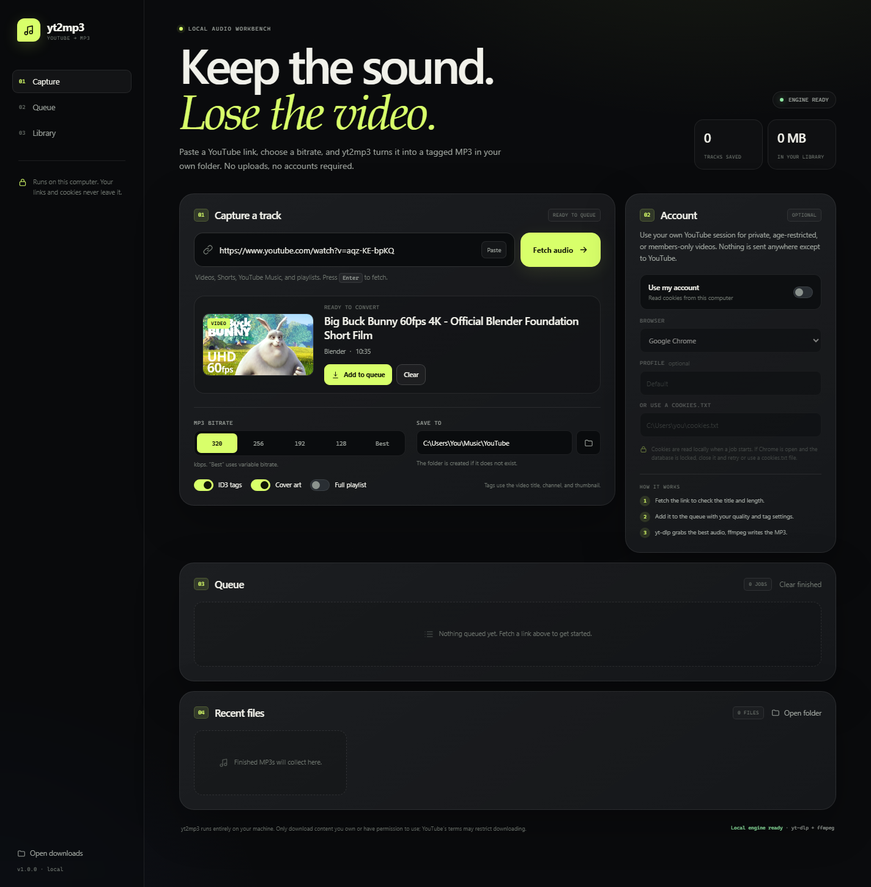

# yt2mp3 — YouTube to MP3

A small, local app that turns YouTube links into tagged MP3 files. Paste a link, check the preview, pick a bitrate, and queue it. Everything runs on your computer; there is no hosted service and no upload step. Packaged builds are available for Windows, macOS, and Linux.



*Screenshot uses the Big Buck Bunny thumbnail © Blender Foundation, [CC BY 3.0](https://creativecommons.org/licenses/by/3.0/).*

## What it does

- Single videos, Shorts, YouTube Music links, and playlists
- 320 / 256 / 192 / 128 kbps MP3, or best-effort VBR
- ID3 tags and cover art embedded by default
- Optional account mode: yt-dlp reads cookies from your browser for private, age-restricted, or members-only content
- Queue with live progress, cancel, retry, and a recent-files library
- Local-only web interface at `http://127.0.0.1:8765`

The heavy lifting is done by [yt-dlp](https://github.com/yt-dlp/yt-dlp) and a bundled ffmpeg binary from `imageio-ffmpeg`. There is no system-wide ffmpeg install required.

## Packaged builds

Download the latest builds from
[GitHub Releases](https://github.com/alienbrainfarm/yt2mp3/releases/latest).
Builds are produced on native GitHub runners by
[the build workflow](.github/workflows/build.yml).

### Windows

1. Extract `yt2mp3-windows-x64.zip`.
2. Keep the `yt2mp3` folder and its `_internal` folder together.
3. Run `yt2mp3.exe`. Downloads and local data are created next to the exe.
4. Use **Quit yt2mp3** in the sidebar to stop the local server.

Windows SmartScreen may warn because the exe is unsigned. Check
`SHA256SUMS.txt` against the archive before running it.

### macOS

1. Extract `yt2mp3-macos-arm64.zip` (Apple Silicon) or
   `yt2mp3-macos-x86_64.zip` (Intel).
2. Drag `yt2mp3.app` into Applications.
3. If Gatekeeper blocks it, right-click the app and choose **Open**, or run
   `xattr -dr com.apple.quarantine /Applications/yt2mp3.app`.

The app is not notarized. Data lives in
`~/Library/Application Support/yt2mp3`; MP3s default to `~/Downloads/yt2mp3`.

### Linux

1. Extract `yt2mp3-linux-x86_64.tar.gz`.
2. Run `./yt2mp3/yt2mp3` from the extracted folder.

Data lives in `~/.local/share/yt2mp3`; MP3s default to `~/Downloads/yt2mp3`.
The folder picker uses `zenity` or `kdialog` when available; otherwise type
the path directly.

## Quick start from source

1. Double-click `setup.bat` once. It creates a `.venv` folder and installs the dependencies.
2. Double-click `start.bat`.
3. The app opens in your default browser. Paste a link and press **Fetch audio**.

The first setup downloads roughly 50 MB of Python packages. yt-dlp is the only component that needs regular updates; run `update.bat` when YouTube changes something.

## The account option

Turn on **Use my account**, pick the browser that is signed in to YouTube, and leave the profile blank unless you use a named Chrome profile such as `Profile 1`.

- yt2mp3 does not ask for or store a password.
- Cookies are read locally by yt-dlp when a job starts.
- If Chrome is running and its cookie database is locked, close Chrome completely and retry. Recent Chrome versions may also block cookie extraction; in that case export a `cookies.txt` file and point yt2mp3 at it.
- You can also use account mode just to get past YouTube's "confirm you're not a bot" check.

## Output

By default, files go to `downloads\` next to the app (or next to `yt2mp3.exe` when using the packaged build). Change **Save to** to any folder you can write to; use the folder button to pick one. The app creates the folder if it is missing.

Filename template: the video title, sanitized for Windows. Existing files are not overwritten. A duplicate download may reuse the existing MP3.

## Troubleshooting

**"Sign in to confirm you're not a bot"**  
Turn on **Use my account** and select the browser where you are signed in. If that still fails, close the browser, reopen it, sign in to YouTube, and try again.

**"The browser cookie database could not be read"**  
Close Chrome/Edge completely. Chrome's newer cookie encryption can block tools that read its database; a `cookies.txt` export is the reliable fallback.

**A playlist is huge**  
Leave **Full playlist** off while testing. When it is on, yt2mp3 passes `--yes-playlist` to yt-dlp and downloads every item it can access.

**YouTube changed and downloads fail**  
Run `update.bat`, then restart the app. Extractor fixes are released frequently.

**A file opens but has no cover art**  
Some videos have no usable thumbnail. The MP3 is still valid; the cover-art step is best-effort.

**The port is already in use**  
Close the other yt2mp3 window, or start with a different port:

```powershell
$env:YT2MP3_PORT = "8766"
.\.venv\Scripts\python.exe app.py
```

## Development

```powershell
# Run directly
.\.venv\Scripts\python.exe app.py

# Run without opening a browser
$env:YT2MP3_NO_BROWSER = "1"
.\.venv\Scripts\python.exe app.py
```

The app binds to `127.0.0.1` only. API requests require a per-run token that is injected into the page, so another website cannot drive the local downloader through a simple cross-origin request.

## Building packages

- Windows: run `build_exe.bat` after `setup.bat`.
- macOS / Linux: run `python build.py` in a prepared environment.

The build is a PyInstaller **onedir** package, not onefile: the `_internal`
folder keeps startup fast and avoids extracting FFmpeg to a temp directory on
every launch. `build.py` copies the platform FFmpeg, generates the icon,
adds the license notices, creates the platform archive, and writes
`SHA256SUMS.txt`.

The GitHub Actions workflow builds Windows x64, Linux x86_64, macOS arm64, and
macOS x86_64. Tagged pushes (`v*`) also upload all archives to a release.

Project layout:

```
app.py                 Flask app, job queue, yt-dlp/ffmpeg wrapper
templates/index.html   UI shell
static/app.css         Styles
static/app.js          UI behavior
requirements.txt       Python dependencies
requirements-build.txt PyInstaller/Pillow build dependencies
setup.bat              One-time environment setup
start.bat              Launch from source
update.bat             Update yt-dlp
build_exe.bat          Windows build convenience wrapper
build.py               Cross-platform PyInstaller/package builder
yt2mp3.spec            PyInstaller build definition
assets/icon.ico        Windows application icon
assets/icon.icns       macOS application icon
licenses/              GPL/FFmpeg license texts for binary releases
dist/                  Build output (ignored by Git)
LICENSE                MIT license
THIRD_PARTY_NOTICES.md Dependency and FFmpeg licensing notes
```

## Publishing this repo

The source is safe to publish. The included `.gitignore` keeps the virtual
environment, downloaded MP3s, job history, local settings, and browser
profiles out of Git. Before pushing, confirm that `git status` does not list
anything under `downloads/`, `data/`, `.venv/`, or `.chrome-*`. Never commit a
`cookies.txt` file.

The repo contains source only. The release zip **does** contain a GPLv3
FFmpeg binary, so it ships with `licenses/GPL-3.0.txt`, `licenses/FFMPEG-LICENSE.md`,
and `licenses/FFMPEG_BUILD.txt`. Keep those files in any binary redistribution
and review [THIRD_PARTY_NOTICES.md](THIRD_PARTY_NOTICES.md) before publishing a
release.

## License

MIT. See [LICENSE](LICENSE).

## Legal note

yt2mp3 is a general-purpose local downloader. Downloading content may violate YouTube's Terms of Service and copyright law. Only download content you own or have permission to use. You are responsible for how you use it.
